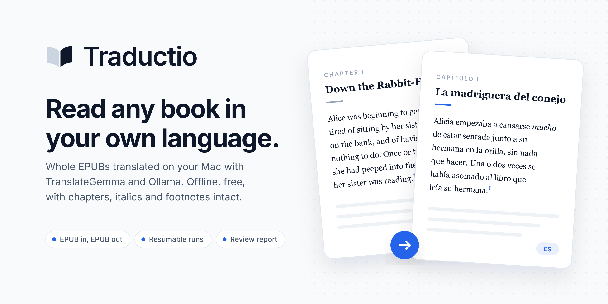

<p align="center">
  <a href="https://github.com/brian-rey-development/traductio/actions/workflows/ci.yml"></a>
  <a href="https://github.com/brian-rey-development/traductio/releases/latest"></a>
  <a href="LICENSE"></a>
  
  
  
</p>

<p align="center">
  <a href="#install">Install</a> ·
  <a href="#mac-app">Mac app</a> ·
  <a href="#translate-your-first-book">First book</a> ·
  <a href="#commands-and-options">Options</a> ·
  <a href="#faq">FAQ</a> ·
  <a href="#known-limitations">Limitations</a> ·
  <a href="#how-it-works">How it works</a>
</p>

Traductio translates whole EPUB books on your own Mac, for free and offline, with Google's TranslateGemma model running in Ollama. You give it a book and get back another EPUB in your language, with its chapters, table of contents, italics, links and endnotes intact, ready to open in Apple Books or any other reader.

|                       |                                                                                                     |
| --------------------- | --------------------------------------------------------------------------------------------------- |
| **Book in, book out** | Chapters, headings, lists, italics, links, endnote markers and the reader's menu survive the trip.  |
| **Private and free**  | Nothing leaves your Mac, and there is no account, API key or per-word bill.                         |
| **Stop any time**     | Every paragraph is saved as it arrives, so Ctrl-C loses nothing and a re-run picks up where it was. |
| **Preview first**     | Translate one chapter in minutes before spending a night on the whole book.                         |
| **Short review list** | A report lists only the paragraphs that look wrong, so you check a dozen instead of thousands.      |

## Install

Paste this into Terminal.

```sh
curl -fsSL https://raw.githubusercontent.com/brian-rey-development/traductio/main/scripts/install.sh | sh
```

The installer sets up everything Traductio needs and skips whatever you already have, so it asks for your password only when Homebrew itself has to be installed. Expect a download of about 18 GB for the two models, and run the same line again whenever you want to update.

<details>
<summary>What the installer does</summary>

1. Clones Traductio into `~/.traductio`.
2. Installs Homebrew, Node, pnpm and Ollama if any of them are missing.
3. Runs Ollama as a background service tuned for long translations, with four parallel request slots, flash attention, a quantized KV cache and one loaded model at a time.
4. Downloads `translategemma:12b-it-q8_0` (13 GB) for translation and `qwen3:8b` (5 GB) for the optional review pass.
5. Links the `traductio` command into `~/.local/bin` and runs `traductio doctor` to confirm everything answers.

To install from a clone you already have, run `./scripts/setup.sh` inside it.

</details>

**Requirements.** A Mac with Apple Silicon and about 25 GB of free disk space. The default model is comfortable with 24 GB of memory, while a 16 GB Mac should add `--model translategemma:12b-it-q4_K_M` to its commands after running `ollama pull translategemma:12b-it-q4_K_M`.

## Mac app

If you would rather not use Terminal after installing, download the `Traductio-…-macOS.zip` file from the [latest release](https://github.com/brian-rey-development/traductio/releases/latest), unzip it and drag Traductio into Applications. Drop a book on the window, pick a language and either the whole book or one chapter, and press Translate. A progress bar shows how far along it is, Stop keeps everything translated so far, and when it finishes you can open the result straight in Apple Books.

The app is a thin layer over the same `traductio` command, so it needs the one-line installer above, and it shows that command with a Copy button if anything is missing. It is signed for your Mac but not notarized by Apple, so the first launch is blocked. Open System Settings, go to Privacy & Security, and press **Open Anyway** next to the Traductio message. That is only needed once.

## Translate your first book

**1. Look inside the book.** This prints its size, a token estimate and a numbered list of chapters.

```sh
traductio inspect book.epub
```

**2. Translate one chapter as a preview.** Pick a chapter number from the list and the target language as a two-letter code such as `es`, `fr`, `de`, `it` or `pt`.

```sh
traductio translate book.epub --to es --chapters 3
```

**3. Translate the whole book.** Start it before bed, because a 500-page book takes around six hours. The chapter you previewed is already done and will not be translated again.

```sh
traductio translate book.epub --to es
```

The result lands next to the original as `book.es.epub`, together with `book.es.report.md`, the list of paragraphs worth a second look. Double-click the EPUB to open it in Apple Books.

## Commands and options

| Command                                  | What it does                                               |
| ---------------------------------------- | ---------------------------------------------------------- |
| `traductio translate <book> --to <lang>` | Translates a book into a new EPUB                          |
| `traductio inspect <book>`               | Shows size, token estimate and the numbered chapter list   |
| `traductio glossary <book>`              | Collects recurring names into an editable `glossary.json`  |
| `traductio doctor`                       | Checks that Ollama is running and the models are installed |

| `translate` option      | Default                      | Effect                                                     |
| ----------------------- | ---------------------------- | ---------------------------------------------------------- |
| `--to <code>`           | required                     | Target language as an ISO code such as `es`, `fr` or `de`  |
| `--from <code>`         | book metadata, else `en`     | Source language                                            |
| `--chapters <list>`     | all                          | Only translate these chapters, given as `3` or `3,5-7`     |
| `--limit <n>`           | all                          | Only translate the first `n` paragraphs                    |
| `--out <path>`          | `<book>.<to>.epub`           | Where to write the translated book                         |
| `--review`              | off                          | Second pass where a general model polishes the draft       |
| `--glossary <file>`     | none                         | Fixed translations for names and terms, used by `--review` |
| `--model <name>`        | `translategemma:12b-it-q8_0` | Translation model                                          |
| `--review-model <name>` | `qwen3:8b`                   | Model for the review pass                                  |
| `--concurrency <n>`     | `4`                          | Parallel requests sent to the server                       |
| `--api <url>`           | `http://127.0.0.1:11434/v1`  | Any OpenAI-compatible server                               |

The model and server defaults can also come from the `TRADUCTIO_MODEL`, `TRADUCTIO_REVIEW_MODEL` and `TRADUCTIO_API_URL` environment variables.

### Keeping names consistent

Fantasy worlds and history books are full of names that should be translated the same way every time, or not at all. The glossary command collects capitalized terms that recur mid-sentence, and the review pass then applies whatever you decide.

```sh
traductio glossary book.epub --out glossary.json
traductio translate book.epub --to es --review --glossary glossary.json
```

Each entry starts as `"term": "term"`. Edit the right-hand side where a term should change, such as `"the Shire": "la Comarca"`, and delete entries that are noise. The glossary only applies during the review pass, because TranslateGemma was trained on one exact prompt format and extra instructions in the first pass hurt its output.

### Reading the report

Every translation is checked for empty output, untranslated text and length ratios that suggest a skipped or invented passage. Anything that fails is listed in the report, most serious first, with the original and the translation side by side.

```markdown
## 3. OPS/chapter03.xhtml

- **markup-lost**: some inline formatting such as italics or links was dropped

> There was nothing so _very_ remarkable in that; nor did Alice think it so _very_ much out of the way...

> No había nada tan extraordinario en eso, ni a Alicia le pareció tan fuera de lo normal...
```

On an 80-paragraph chapter of a densely footnoted biography, the report flagged four paragraphs, all of them book titles or stressed words where the model replaced italics with quotation marks.

## FAQ

<details>
<summary>Which languages work?</summary>

Any pair TranslateGemma handles, which covers the major European and Asian languages, written as ISO codes such as `es`, `fr`, `de`, `it`, `pt`, `nl`, `ja`, `zh` or `ko`. The source language is read from the book's metadata, and `--from` overrides it when the metadata is wrong.

</details>

<details>
<summary>Can it translate Kindle, PDF or DRM-protected books?</summary>

Traductio reads DRM-free EPUB files only. Convert other formats you own to EPUB with [Calibre](https://calibre-ebook.com) first. Books bought with DRM stay encrypted, so their text cannot be read by any tool.

</details>

<details>
<summary>How long does a book take, and can it go faster?</summary>

Generation on Apple Silicon is limited by memory bandwidth, because every generated word streams the full model through the GPU. On an M5 Pro with 24 GB the default model translates 12 to 15 paragraphs a minute, so a 500-page book of about 4,900 paragraphs takes around six hours. The `translategemma:12b-it-q4_K_M` model reads 8 GB per step instead of 13 and runs about 1.5 times faster at a small cost in quality. Because `--api` accepts any OpenAI-compatible server, the same command can also run against LM Studio, `mlx_lm.server`, or vLLM on a rented GPU when a book has to be done in minutes.

</details>

<details>
<summary>What happens if my Mac sleeps or I close the Terminal?</summary>

Nothing is lost. Every translated paragraph is stored in `~/.cache/traductio/` the moment it arrives, so running the same command again skips everything already done. Changing the model or the target language starts a separate cache, because those produce different translations.

</details>

<details>
<summary>How do I uninstall it?</summary>

```sh
~/.traductio/scripts/uninstall.sh            # removes Traductio, its service, cache and command
~/.traductio/scripts/uninstall.sh --models   # also deletes the two downloaded models
```

Ollama and Homebrew stay installed, since other tools may rely on them.

</details>

## Known limitations

- **EPUB only.** Kindle, PDF and DRM-protected books need converting to a DRM-free EPUB first.
- **Italics sometimes turn into quotation marks.** TranslateGemma tends to put book titles and stressed words in quotes. The report lists every paragraph where that happened.
- **Endnote markers can land one sentence off** when the translation merges or splits sentences around them.
- **Right-to-left languages are not finished.** Arabic, Hebrew and Persian text comes out translated, but the book keeps left-to-right direction, so some readers align it wrong.
- **Image descriptions stay untranslated.** Text inside `alt` attributes is left as it was.
- **It is slow.** A long book is an overnight job on Apple Silicon, and the setup script only targets macOS, although the CLI works with any OpenAI-compatible server through `--api`.
- **The Mac app is not notarized**, so macOS asks you to allow it once.

## How it works

The reasoning behind the main design choices, including what was tried and what each choice costs, is written up in the [decision records](docs/adr/README.md).

<details>
<summary>From EPUB to segments and back</summary>

Every content file in the spine is parsed as XHTML, together with the navigation document and the NCX table of contents, so chapter titles in the reader's menu come out translated too. Text is cut into segments at block boundaries, which means a paragraph, a heading or a list item is one segment, and text that sits beside a nested block (the "Item" in `<li>Item<ul>...</ul></li>`) becomes its own segment instead of being skipped. Preformatted text, scripts, SVG and MathML are left alone.

Inline elements inside a segment are replaced by numbered placeholders, so `Alice was <em>very</em> tired` is sent as `Alice was <1>very</1> tired`. Models are sloppy with placeholders, so the restore step is deliberately forgiving. Closing tags are matched by nesting order rather than by number, which is safe because XHTML cannot contain overlapping tags. Dropped anchors are put back on the side of the paragraph they came from, and a newline the model wrote in place of a `<br/>` becomes that `<br/>` again.

Endnote markers such as `<sup>4</sup>` get special care, because TranslateGemma tends to drop them and start a new paragraph where they sat. When a marker goes missing, Traductio counts which sentence it closed in the source, skipping abbreviations like "Mrs." or "John D." that the translation usually spells out, and puts it back after the sentence in the same relative place in the translation. Only a formatting pair the model dropped entirely is lost, and only for that span, which the report records as `markup-lost`. TranslateGemma also likes to end every output with a period, so a period is removed when the source segment did not end with punctuation, which keeps headings clean.

</details>

<details>
<summary>Long paragraphs, the review pass and quality checks</summary>

Paragraphs longer than about 2,400 characters are split on sentence boundaries to stay inside TranslateGemma's 2K-token input window, and that limit shrinks for Chinese, Japanese and Korean sources because those scripts pack more tokens into each character.

The optional review pass runs after the whole first pass finishes, so the translator and the reviewer never share memory. The reviewer sees the original and the draft side by side, and its revision is accepted only when it keeps at least as much formatting as the draft and stays within a sane length of it. Empty or truncated completions are never cached, so a re-run asks the model again.

Every final translation is checked for empty output, untranslated text and length ratios that suggest an omission or an invented passage, with the expected ratio adjusted for dense scripts such as Chinese and Japanese.

</details>

## Development

```sh
pnpm check       # typecheck, lint, format check and tests
pnpm format      # rewrite the tree with Prettier
pnpm test        # unit, property and end-to-end tests against a fake model server
./macos/build.sh # builds Traductio.app and the release zip into macos/build/
```

Node 24 runs the TypeScript sources directly, so there is no build step. The source is organized in layers, and imports only ever point downward into the list below, which keeps the dependency graph acyclic and makes each folder readable on its own.

```text
src/cli/         argument parsing, commands and console output
src/translate/   translation pipeline, prompts, checks, report and progress
src/llm/         OpenAI-compatible client, completion cache and deduplication
src/epub/        EPUB package handling, XHTML documents, segments and markup
src/shared/      defaults, guards and the concurrency pool
macos/           the SwiftUI app, which runs the CLI and reads its output
```

Formatting is owned by Prettier and the lint gate runs the type-checked rule set, so floating promises, unsafe values from external payloads, functions over 20 lines and files over 250 lines all fail `pnpm check` instead of relying on review to catch them. The console API is only allowed inside `src/cli/` because that layer owns user-facing output, and every other layer reports through return values and thrown errors. The markup restore step, where most of the risk lives, also has property tests that throw thousands of randomly broken model answers at it and check that the result is always valid XHTML with every anchor kept exactly once.

The logo, icons and cover in `assets/` are generated by `scripts/brand/generate.py`, which needs `rsvg-convert`, the Inter font and `pip install uharfbuzz fonttools`, so a color or tagline change is one edit and one run away.

## Responsible use

Traductio is meant for books you own or that are in the public domain, translated for your own reading. A machine translation of a copyrighted book is still a derivative of that book, so sharing or selling one needs the rights holder's permission.

## License

[MIT](LICENSE) © Brian Rey
